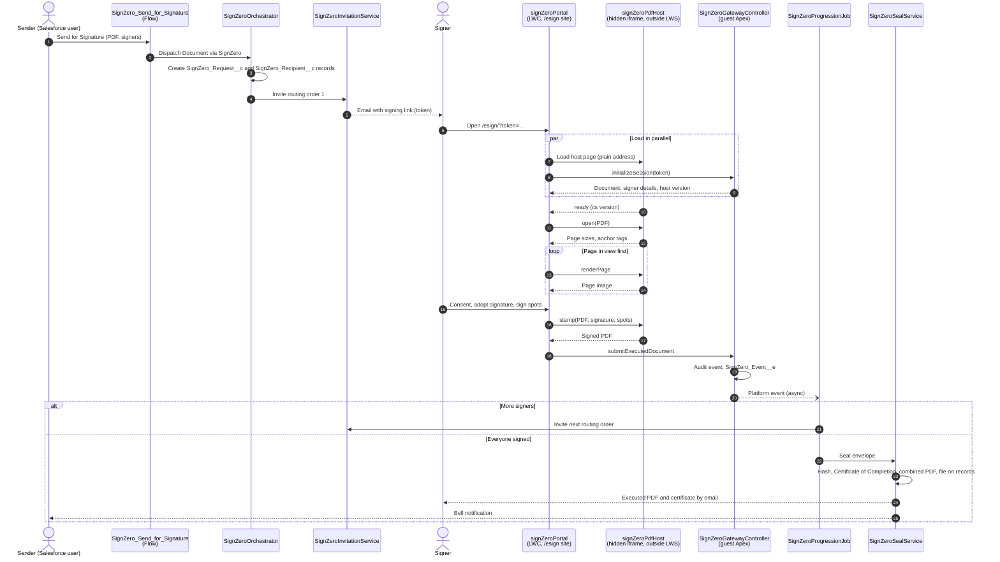
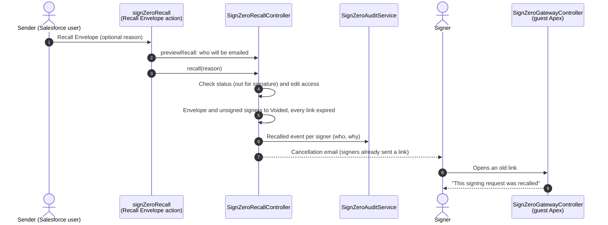

# Signing flow

How an envelope moves from sending to sealing, and where each piece runs.

## Recall

While the envelope is out for signature, the sender can recall (void) it from the Signature Request.

## Where things run

| Layer | Runs | Notes |
|---|---|---|
| Flow, Orchestrator, Invitation, Progression, Seal | Salesforce (Apex) | Progression and sealing run as the Automated Process user from the platform event |
| Gateway | Salesforce (Apex), as the site guest user | The only Apex the site can call; every method checks the token first |
| Portal | Signer's browser, inside Lightning Web Security | Layout, consent, signature capture, guided signing |
| PDF host page | Signer's browser, in a same-site iframe outside LWS | PDF.js with its Web Worker, and pdf-lib; no Salesforce access |
